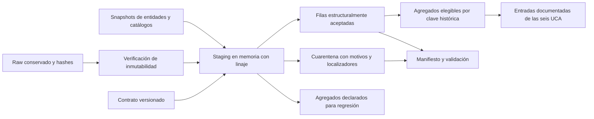

# Misión 03 — Integridad, procedencia y preparación de datos

Fecha de corte: 2026-11-07, America/Mexico_City. Rama: `feature/academic-multiagents`. HEAD de referencia: `00d2ca39aeecf7feba863838c509bb15a6b80dba`. Estado: corrección local y preparación de inventario ejecutadas; publicación y homologación territorial contemporánea pendientes.

## Insumos y continuidad

Se reutilizaron el [diagnóstico de Misión 02](mision-02-datos.md), su [consolidado](../mision-02-consolidado.md) y el [mapa de entregables](../mapa_entregables_uca.md). Se inspeccionaron instrucciones, configuración, scripts reales, pruebas y consumidores antes de modificar el código. Los cambios previos de `.gitignore`, `.codex/`, `AGENTS.md`, documentos y scripts académicos se conservaron. Los informes anteriores permanecen sin sobrescritura. No se repitió investigación externa ni se solicitaron APIs.

[OBSERVADO] Los insumos principales son los índices locales `research/entities/*/index.json`, cuatro registros de fuentes y `research/generated/municipality-region-map.json`. La dimensión histórica conserva evidencia de ITER 2020/PDU y fecha declarada de generación 2026-10-05. No se acredita por esa fecha una versión de límites vigente en 2026. El ETL lee los índices, pero excluye la ruta editorial del universo de controles; el contexto estatal de 2022 no se convierte en filas municipales.

El [manifiesto de ejecución](../../../research/curated/mission03/manifest.json) registra ruta, bytes y SHA-256 de entradas, código, contrato, originales crudos y salidas. El [baseline](../../../research/curated/mission03/baseline-audit.json) y la [copia municipal anterior](../../../research/curated/mission03/municipalities-before.json) permiten auditar la corrección. Los localizadores de fila son base cero y se interpretan contra el hash exacto de entrada.

## Defectos y transformaciones ejecutadas

| Hallazgo [OBSERVADO] | Transformación ejecutada | Garantía / alcance |
|---|---|---|
| El builder comparaba claves municipales mediante igualdad sin excluir `null` | Se añadieron `isValidMunicipalityId` y `validMunicipalityJoin` y se aplicaron a conteos, destinos y unión de eventos | Dos claves nulas, vacías, numéricas, mal formadas o de total estatal no establecen pertenencia |
| La vista municipal repetía igualdad nula para varias colecciones | Se protegieron `inMuni`, destinos, eventos y `muniById` en `src/data/portal.ts` | Las fichas sin clave no se incorporan a Villa de Pozos |
| Los indicadores sustituían una clave ausente por un nombre y conteos ausentes por cero | Se retiró el fallback de nombre y se exigieron clave admitida y ocho conteos completos enteros no negativos | Las filas territoriales no aptas salen del universo analítico; no se inventa un cero |
| La búsqueda de evento sólo descartaba claves vacías | Se exigió clave sintácticamente válida e igualdad válida en `eventOf` | No se bonifica un destino por un evento con clave territorial inválida |
| La ficha municipal derivada de Pozos contenía atribuciones por `null` | Se retiraron cuatro relaciones y se sustituyeron sus nueve conteos por `null`; se añadieron estado y versión de corrección | Se conservó el original; sólo cambió esa fila del snapshot municipal |
| Entidades con falta de claves, nombres o fuentes | Se particionaron en aceptadas y cuarentena por motivos, sin borrar ni imputar | Los localizadores originales siguen disponibles |
| Dos IDs de fuente tienen variantes de catálogo | Se conservaron todas las variantes con PK por archivo/hash/fila | No se aplica precedencia silenciosa |
| Relaciones desde filas aceptadas hacia cuarentena | Se separaron referencias declaradas, elegibles y retenidas | Siete relaciones se conservaron como declaradas y quedaron fuera de las FK elegibles |

La protección sintáctica del runtime no certifica pertenencia cartográfica ni vigencia temporal; en el ETL se exige además correspondencia con el catálogo documentado. [SIN_DATOS] El catálogo contemporáneo autenticado y la tabla de correspondencias no se encuentran disponibles en este alcance. Los 132 registros con `24059` se mantienen como declarados en cuarentena. No se inventa una clave para Pozos, ni se reasigna población de 2020 o región turística. Los intervalos legales desconocidos se representan con `valid_from:null` y `valid_to:null`.

## ETL real y arquitectura



[OBSERVADO] `scripts/academic/etl-mission03.mjs` ejecuta el ETL local sin red, dependencia nueva, reloj ni aleatoriedad. La función `buildMission03({root,outputDir,write})` permite producir salidas en directorios de prueba. El builder histórico completo no se ejecutó, pues regeneraría otros snapshots. El staging se realiza en memoria; no se afirma procesamiento distribuido ni streaming. La escala local permite ficheros JSON y controles deterministas. El costo de verificar hashes crudos es lectura local, sin cuota de API; no se presenta como benchmark de rendimiento.

| Producto en `research/curated/mission03/` | Uso y estado |
|---|---|
| `entity-snapshot.json` | Asientos aceptados con coordenadas y medidas como declaradas, linaje y puertas de elegibilidad |
| `quarantine.json` | Filas no aceptadas con causas superpuestas y localizador original; resolución pendiente |
| `municipality-versions.json` | Dimensión de claves históricas, hash de catálogo, intervalos legales desconocidos y límites explícitos |
| `source-snapshots.json` | Variantes de metadatos de fuente; no confundir hash de registro con hash del recurso externo |
| `duplicate-candidates.json` | Grupos por nombre normalizado para revisión, sin fusión automática |
| `municipal-aggregates.json` | Reconstrucción segura del universo declarado para regresión; incluye filas en cuarentena |
| `eligible-municipal-aggregates.json` | Sólo inventario aceptado; denominadores declarados y admitidos por municipio; entrada para análisis posterior |
| `validation-report.json`, `manifest.json` | Conservación, FK, diferencias, exclusiones y hashes |
| `baseline-audit.json`, `municipalities-before.json`, `raw-manifest-before.json` | Baselines conservados como entradas de verificación |

`measures_as_declared.counts` conserva los conteos previos de las fichas municipales; no constituye el universo elegible nuevo. Los análisis posteriores deben usar el producto de agregados elegibles y su denominador. La aceptación para inventario no valida licencias, vigencia operativa, un punto de acceso ni comparabilidad de límites. Todas las banderas de publicación y de comparación temporal territorial permanecen falsas.

## Resultados y comparación

[DERIVADO] Las cifras siguientes provienen de `validation-report.json`, corte local del 2026-11-07. Unidad: filas de inventario o elementos de catálogo según la columna. Fórmula de conservación: `4,961 = 4,805 + 156`. La aceptación no fue una categoría calculada por Misión 02; por ello no se presenta una cifra anterior de aceptados ficticia.

| Control | Antes | Después | Interpretación |
|---|---:|---:|---|
| Filas de entidades auditadas, sin rutas | 4,961 | 4,961 | Conservación del universo de entrada |
| Filas estructuralmente aceptadas | No calculado | 4,805 | Incluyen 58 filas de dimensión municipal; inventario no municipal admitido: 4,747 |
| Filas únicas en cuarentena | No calculado | 156 | Los motivos se superponen |
| Filas de directorio municipal | 59 | 59 | Las páginas y el placeholder de Pozos se conservan |
| Filas de indicadores municipales del portal | 59 | 58 | Se excluyó la fila sin clave; no se borró su página |
| Claves municipales comparables con indicadores idénticos | 58 | 58 | Igualdad de todos los campos, evidencia QA |
| Filas de fuentes / IDs distintos | 112 / 110 | 112 / 110 | Se retuvieron variantes, sin eliminarlas |
| Grupos candidatos por nombre | 103 | 103 | Revisión, no duplicados de negocio certificados |
| Referencias de destinos atribuidas a Pozos | 4 | 0 admitidas | A03, A15, H02 y H18 quedan sin atribución automática |
| Conteos de Pozos: destinos / arqueología / eventos | 4 / 1 / 4 | Desconocidos (`null`) | No equivalen a cero turístico |

[DERIVADO] Se verificaron 1,160 archivos crudos, 701,965,348 bytes, con coincidencia de ruta, tamaño y SHA-256 antes y después. Su preservación no acredita calidad intrínseca ni actualidad de sus observaciones. No se modificaron los otros snapshots de entidades.

| Motivo de cuarentena | Filas |
|---|---:|
| Clave municipal ausente o inválida | 14 |
| Clave sin correspondencia local (`24059`) | 132 |
| Sin fuente | 9 |
| Sin nombre | 3 |
| Sin ID | 1 |
| Referencia nula o inválida de fuente | 1 |

Estas cifras no se suman como registros únicos: el total de filas afectadas es 156. No se detectaron IDs repetidos ni coordenadas inválidas en el corte; los casos negativos se validaron con fixtures claramente separados del inventario real. Los 103 grupos homónimos no se eliminaron porque pueden representar sucursales o asientos de proveedores diferentes.

[DERIVADO] Los agregados del inventario admitido difieren de los declarados en los casos siguientes, por exclusión documental explícita; no representan disminución de oferta real. Las fichas públicas de las 58 claves válidas conservan sus indicadores anteriores.

| Clave | Medida, unidad registros | Declarado | Elegible |
|---|---|---:|---:|
| 24003 | destinos | 5 | 4 |
| 24006 | destinos | 4 | 3 |
| 24024 | destinos | 4 | 3 |
| 24028 | destinos | 10 | 6 |
| 24037 | alimentos | 73 | 72 |
| 24054 | alojamiento | 61 | 60 |

La evidencia reproducible se encuentra en `validation-report.json:eligible_aggregate_changes`. La falta de fuente excluyó siete destinos de esos conteos; dos establecimientos sin nombre explican los cambios en alimentos y alojamiento. Otro registro sin nombre no pertenece a esas categorías de agregado. Las pérdidas de cobertura deben acompañar cualquier análisis posterior.

## Contrato, pruebas y decisiones transferidas

Se produjo [campaign-data-v1.0.0](contrato-datos-v1.md) y su [catálogo procesable](contracts/campaign-data-v1.0.0.json). El contrato define PK/FK, tipos, unidades, nulabilidad, coordenadas declaradas, procedencia, derechos, tiempo territorial, puertas de elegibilidad y esquemas de intercambio para las seis UCA. El JSON es un catálogo de campos y reglas, no un JSON Schema ni un validador universal. Los controles ejecutables residen en el helper de integridad, ETL y pruebas; las reglas de derechos, actualidad y compatibilidad territorial que requieren evidencia externa permanecen bloqueadas.

Las verificaciones independientes y sus resultados se registran en [QA Misión 03](mision-03-qa.md); la comparación de indicadores queda en [regresión municipal](mision-03-regresion-municipal.json). Se aplicaron casos negativos de joins nulos, claves inválidas, duplicados, FK, coordenadas, fechas y municipios sin correspondencia. La prueba de integración reconstruye dos salidas temporales, compara bytes con el candidato persistido y verifica conservación de raw, PK/FK y agregados elegibles.

[DERIVADO] El cierre de QA aprobó 128 pruebas pertinentes: datos 8, inteligencia 78 y geografía 42. El adaptador de destinos utiliza la clave de su registro de origen; una prueba real comparó las asociaciones de 63 destinos con las 58 claves admitidas y no encontró diferencias frente a las asociaciones previas. El check final examinó 202 archivos: cero errores, cero warnings y diez hints de símbolos sin uso. El build estático y la comprobación de sus salidas se documentan en el consolidado.

Comandos de reproducción desde la raíz:

```powershell
npm run data:prepare
npm run test:data
npm run test:intel
npm run test:geo
npm run check
$env:BASE_PATH='/san-luis-potosi-web'
$env:SITE_URL='https://elgueraai.github.io'
npm run build
```

No se requiere ejecutar scripts de descarga o el generador histórico completo. Cambiar legítimamente un insumo invalidará los conteos del corte y exigirá actualizar el baseline mediante revisión, sin reescribirlo silenciosamente. `data:prepare` falla si cambia raw respecto al baseline o si los controles de conservación, FK y agregados declarados no concuerdan.

## Limitaciones y siguiente dependencia

[SIN_DATOS] Permanecen pendientes: versión municipal contemporánea autenticada, polígonos/correspondencias, región oficial de Pozos, fechas observacionales suficientes por asiento, licencias por recurso y afirmación, vigencia de eventos y operación. Las coordenadas válidas numéricamente no certifican acceso. La resolución de homónimos y los 156 casos en cuarentena requieren evidencia adicional; se conserva su trazabilidad.

[HIPÓTESIS] Para la Misión 04 se propone diseñar medición agregada y consentida, minimización, retención, rechazo/revocación y explicación de transferencias a proveedores. El paquete admitido permite diseñar cobertura y selección de inventario con exclusiones; no contiene afluencia ni resultados de campaña. Las UCA de minería, ML, estocásticos e IO podrán consumir los esquemas documentados cuando sus observaciones y supuestos sean suficientes. No se entrenaron modelos ni se optimizó inversión.

La misión queda sujeta a revisión humana de checkpoint. No se realizó commit, push, merge, despliegue ni publicación; no se modificó el diseño premium.
